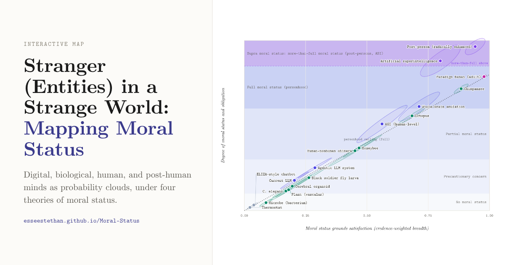

# Strange Minds Moral-Status Map

An interactive, uncertainty-sensitive map of possible moral status across digital, biological, human, and post-human entities.

**[Open the live map → esseestethan.github.io/Moral-Status](https://esseestethan.github.io/Moral-Status/)**

[](https://esseestethan.github.io/Moral-Status/)

## What the map does

- Maps credence-weighted moral-status grounds against degree or tier of moral status.
- Represents entities as probability clouds and 95% credible regions rather than fixed points.
- Compares linear, sigmoid, threshold, and multi-criterial theories.
- Distinguishes full personhood from supra, or more-than-full, moral status.
- Lets users edit entities, grounds, confidence, and precautionary assumptions.
- Generates provisional duties from both degree and dominant grounds.

Everything runs in the browser; nothing is sent anywhere. Use **Save and load a configuration** to export your settings as JSON and share them with others.

## Epistemic status

The numerical defaults are illustrative inputs for structured deliberation, not settled empirical estimates or moral verdicts. The tool operationalizes competing philosophical views without adjudicating among them. Sources are listed in the app under **Sources and basis**.

## Running it locally

Requires [Node.js](https://nodejs.org/) 20 or later.

```bash
npm install
npm run dev
```

Then open the address Vite prints (by default `http://localhost:5173/Moral-Status/`).

| Path | What it is |
| --- | --- |
| `src/MoralStatusMap.jsx` | The whole app: model, map, pairwise plot, and controls |
| `src/main.jsx` | Mounts the app into `index.html` |
| `src/styles.css` | Self-hosted Computer Modern fonts and page-level styles |
| `public/` | Favicon and the link-preview image |

## Deployment

Every push to `main` runs [`.github/workflows/deploy-pages.yml`](.github/workflows/deploy-pages.yml), which builds the site and publishes it to GitHub Pages. Pull requests run the same build as a check without deploying.

**One-time setup:** GitHub Pages has to be switched on once in the repository settings. The workflow cannot do this itself.

1. Go to **Settings → Pages**.
2. Under **Build and deployment → Source**, choose **GitHub Actions**.
3. Re-run the latest **Deploy to GitHub Pages** run from the **Actions** tab, or push to `main`.

## Credits

Created by Ethan C. Terrill in collaboration with Claude. Typeset in Computer Modern (Donald Knuth), via the OFL-licensed [`computer-modern`](https://www.npmjs.com/package/computer-modern) package.
